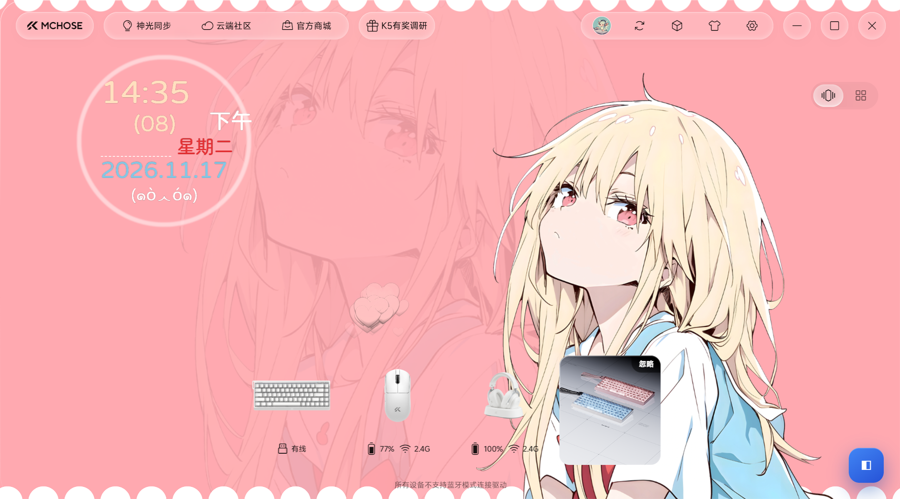

# M HUB 壁纸

把 Wallpaper Engine 的壁纸放到 M HUB（迈从驱动）的界面背景上。

- **场景壁纸**：直接在驱动页面里实时渲染，粒子、动画、鼠标视差都在
- **视频壁纸**：当背景视频放
- 右下角按钮换壁纸，可以调亮度、缩放、帧率这些
- 切到别的程序或最小化时，自动把渲染放掉，不占显卡



## 环境

```
Windows 10 / 11
Node.js 22+
M HUB、Wallpaper Engine
Edge + FFmpeg（可选，只有把场景转成视频时才用）
```

## 安装

```
1. 解压到任意目录，比如 E:\MCHOSE-WE
2. 右键 install.ps1 → 用 PowerShell 运行（需要管理员）
3. 之后用桌面的 M HUB 快捷方式启动
```

M HUB 本身是管理员权限跑的，注入也得管理员，所以安装时会把快捷方式改成走后台任务，
这样平时打开就不会一直弹 UAC。

## 用法

- 右下角圆形按钮打开选择器（或托盘图标）
- 点卡片直接换，点一次就换，不用点两次
- 卡片右上角 ✕ 从列表移除，只隐藏不删文件，设置里可以恢复
- 齿轮里是画面、性能、以及壁纸自己带的参数

## 文件结构

```
server.js          本地服务：壁纸流、参数、设置
watchdog.js        后台守护：带端口启动 M HUB、注入、掉线自愈
inject-ui.js       通过 CDP 把界面注入进去
ui/page.js         界面和渲染的全部逻辑
catalog.js         扫创意工坊，列出可用壁纸
bake.js            场景转视频（实时渲染失败时的兜底）
lib/config.js      自动找 Edge / FFmpeg / M HUB / 创意工坊路径
tray.ps1           托盘
start.ps1          手动启动用（等价于跑守护）
install.ps1        安装：写配置、建快捷方式、可选开机自启
```

## 开发

```bash
node server.js          # 只起服务
node inject-ui.js       # 手动注入一次（M HUB 要带调试端口）
```

日志：`watchdog.log`

## 注意

- 直接双击 `MCHOSE HUB.exe` 会因为没有调试端口被重启一次，用快捷方式就好
- 实时渲染是真的在渲染，会占 GPU，和 WE 本体一个量级
- 个别壁纸缺 `scene.pkg`，会显示不支持
- 只在 Windows + 单屏环境下测过
- 跟 MCHOSE、Wallpaper Engine、Steam 官方没有关系，用出问题自负

## 许可

MIT，见 [LICENSE](LICENSE)。
内置的 WebWallGL 也是 MIT，版权归原作者，声明见 [NOTICE.md](NOTICE.md)。
